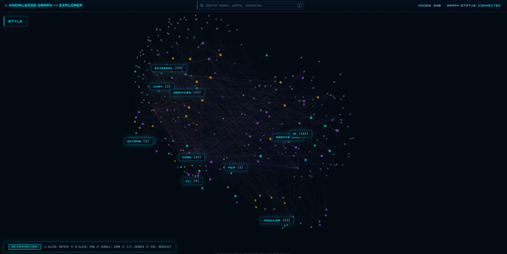
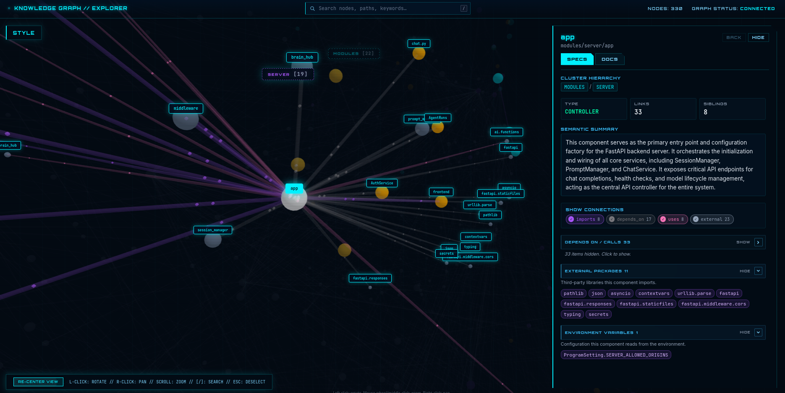

# Knowledge Graph


A small 3D viewer for the project knowledge that [JARVIS AI](https://github.com/tugapse/ai) generates.
Point it at the knowledge, fly around your codebase, click things.



---

## Why

[JARVIS AI](https://github.com/tugapse/ai) can document a project for its agents (`ai knowledge build`).
The model reads every source file once and writes down what the file does, its symbols, its
dependencies and a Markdown doc. The agents love it. Me, not so much: it's hundreds of JSON files,
and you can't *see* a codebase by reading JSON one file at a time.

So I wanted to look at it. Not a table, a proper graph you can rotate and zoom into, with modules
grouped by subsystem, dependencies as links, and the docs one click away. And since the assistant
is called JARVIS, it had to look like a holographic HUD from a lab in Malibu.

It started in November 2026 as a plain HTML + JavaScript viewer (JARVIS still has a copy in its
`docs/` folder). It has since moved into its own repo, been rewritten in Angular, and picked up a
proper inspector, search and a style panel along the way.

It's a pet project: a side tool for a side project, built for fun. It's not a product, and it
changes whenever I feel like it. It's open source in case it's useful or fun for someone else.

## What it can do today

- **3D graph** of the whole project: nodes orbit their subsystem, subsystems orbit each other.
- **Floating labels**: cluster badges and node names hover over the scene. Click a badge to focus a whole subsystem.
- **Inspector**: for each node it shows the type, signature, semantic summary, keywords, external
  packages and env vars, plus *Depends on* and *Used by* lists you can filter by relation.
  The *Docs* tab renders the Markdown JARVIS wrote.
- **Search** with `/` or `Ctrl+K` over names, keywords, summaries, types and clusters.
- **Style panel**: colors, sizes, opacities, link particles, labels and physics. Saved in your browser.
- **Fills in the gaps**: merges duplicate nodes and adds `uses` links for dependencies that only
  show up in the docs (marked `DOCS`).
- **Live or static**: a local server that re-reads the knowledge on every refresh, or a static bundle
  you can drop on any web server.

## Status

- Personal project, one maintainer, developed in bursts. Expect breaking changes.
- Developed on Linux. Nothing here should be Linux-only, but nothing else gets tested either.
- It's made for JARVIS's knowledge format. Anything that writes the same [JSON](#the-input-format) works too.
- How good the graph looks depends a lot on how good the knowledge is, which depends on the model
  that built it.

---

## Getting started

You'll need **Python 3.10+** and **Node.js/npm**. The Python side only uses the standard library;
npm builds the client.

```bash
git clone https://github.com/tugapse/knowledge-graph.git
cd knowledge-graph
./run.sh -k ~/Code/ai/_knowledge -d ~/Code/ai/_docs
```

On the first run it installs the npm dependencies, builds the client, starts a server on
<http://localhost:8080> and opens your browser.

The defaults are `-k _knowledge -d _docs`, the folders JARVIS writes to. So from inside a project
JARVIS has documented, this is enough:

```bash
/path/to/knowledge-graph/run.sh
```

### First steps

```bash
./run.sh -k ./_knowledge -d ./_docs                    # serve on :8080 (builds the client if needed)
./run.sh -k ./_knowledge -d ./_docs -p 9000            # another port
./run.sh -k ./_knowledge -d ./_docs -r src/ai          # strip a deeper root so subsystems start below it
./run.sh -k ./_knowledge -d ./_docs --rebuild-client   # fresh npm run build, then serve
./run.sh -k ./_knowledge -d ./_docs -b ./dist/site     # build a static site instead of serving
./run.sh -k ./_knowledge -b ./dist/site --skip-client-build   # only refresh data.json in it
```

The static site is plain files with a relative `base href`, so it works from any sub-path:

```bash
python3 -m http.server -d dist/site
```

`./run.sh --help` lists every option. Set `PYTHON_ENTRY` to use another interpreter.

| Flag | Default | What it does |
| --- | --- | --- |
| `-k`, `--knowledge DIR` | `_knowledge` | Component JSON files (searched recursively). |
| `-d`, `--docs DIR` | `_docs` | Markdown docs, found through each component's `doc_path`. |
| `-p`, `--port N` | `8080` | Server port. |
| `-r`, `--root PATH...` | | Extra path prefixes to strip before grouping. `src`, `app` and `lib` are always stripped. |
| `-b`, `--build [DIR]` | `./dist/site` | Build a static bundle (client + `data.json`) instead of serving. |
| `--skip-client-build` | | With `-b`: reuse the existing client build. |
| `--rebuild-client` | | Server mode: rebuild the client even if a build exists. |

---

## A quick tour

**Getting around.** Left drag rotates, right drag pans, scroll zooms. Click a node or a cluster
badge to focus it; the camera flies over and everything unrelated fades out. `Esc` deselects,
**Re-center view** resets the camera.

**The inspector.** The *Specs* tab is the structured part: cluster breadcrumbs, type, links,
signature, summary, and the two lists that matter most. *Depends on / Calls* is what this file
needs; *Used by* is what breaks if you change it. Click any entry to jump there, and **Back** to
return. The *Docs* tab is the Markdown JARVIS wrote for that file.



**Search.** `/` or `Ctrl+K` anywhere. It matches names first, then keywords, summaries, types and
cluster names, and tells you why each result matched.

**Style panel.** Everything visual is a knob: node colors by type, link colors by relation, cluster
level colors, sizes, opacities on selection, particles, labels, background and physics. It's
saved in `localStorage`, and **Reset all** is there for when it gets out of hand.

**Live vs static.** In server mode `data.json` is rebuilt on every refresh, so run
`ai knowledge build` in another terminal and just hit F5. The static bundle is a snapshot, good for
sharing or hosting next to the project.

---

## The input format

This is what `ai knowledge build` writes: one JSON file per source file.

```jsonc
{
  "component": {
    "name": "memory_manager",
    "type": "module",                          // becomes the node type
    "source_path": "ai/agents/memory_manager.py",
    "doc_path": "ai/agents/memory_manager.md"  // looked up under --docs
  },
  "vector_memory": {
    "semantic_summary": "Per-agent memory: messages, history, notes ...",
    "vector_summary_keywords": ["memory", "agents"]
  },
  "metadata": {
    "external_dependencies": ["tiktoken"],     // become EXTERNAL nodes
    "environment_variables": ["AI_ASSISTANT_DIRECTORY"]
  },
  "graph_nodes": [
    { "id": "MemoryManager", "name": "MemoryManager", "label": "class", "signature": "class MemoryManager(...)" }
  ],
  "graph_edges": [
    { "source": "MemoryManager", "target": "ai/agents/agent_io.py", "relation": "depends_on" }
  ]
}
```

What the loader does with it:

- **One name per thing.** Paths and imports are normalized to a single key
  (`src/ai/agents/memory_manager.py` and `ai.agents.memory_manager` both become `agents/memory_manager`).
- **Subsystems.** The first meaningful folder becomes the cluster (`AGENTS`, `CORE`, `TOOLS`, ...).
  Third-party packages go under `EXTERNAL`.
- **Docs.** From the Markdown it takes the `## 1. Overview & Purpose` section, the
  `**Side Effects:**` entry and the full text.
- **Links.** Edges are resolved through an alias table. Unknown targets fall back to their parent
  module or become an external placeholder. Duplicates and self-loops are dropped.

The result is a single `{ "nodes": [...], "links": [...] }`, served at `/data.json` (and `/api/data`).

---

## How it's organised

```
 Python (stdlib)   run.sh → main.py → graph_loader.py → data.json
                                    → server.py (serves the client + data.json)
                                    → frontend.py (npm ci / npm run build)
 Angular client    viewport (3D scene) · HUD (labels, top bar) · search · inspector · style panel
                   services: graph state · cluster hierarchy · persisted style
```

```
server/            Python loader + server
src/components/    graph-viewport · graph-hud · graph-search · graph-inspector · graph-style-panel
src/services/      state, hierarchy and style services
src/core/          models, default config, client-side normalization
tests/             Python tests for the loader
public/data.json   sample data for the dev server
client/            the original vanilla-JS viewer, kept for reference (not built)
```

### Hacking on it

Run the Python server for the data and the Angular dev server for hot reload.
`proxy.conf.json` sends `/api` and `/data.json` to port 8080.

```bash
npm install
./run.sh -k ./_knowledge -d ./_docs   # terminal 1: data on :8080
npm start                             # terminal 2: client on :4200
```

```bash
npm test                              # Angular tests (Vitest)
python3 -m unittest discover tests    # loader tests
npm run build                         # → dist/knowledge-graph/browser
```

## What's next

No big promises. The focus for now is:
- making it handle bigger projects without turning into a hairball;
- quality-of-life improvements (to be defined as I go).

## Contact

**Maintainer:** Fabio Almeida · tugapse@gmail.com
